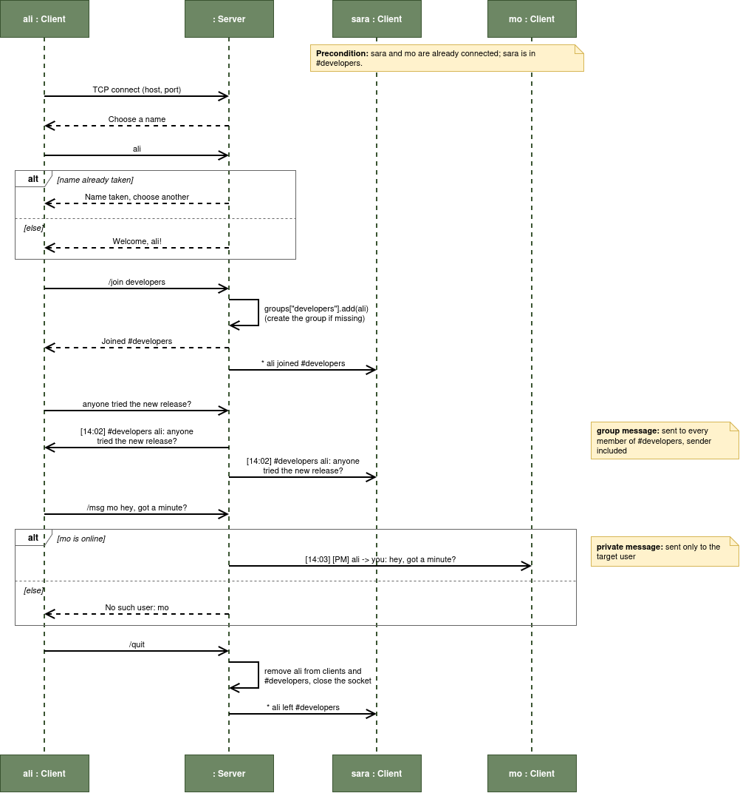

# simple-IRC

A simple, open source, IRC-like chat that runs in your terminal.
Talk with your friends in groups or send private messages, with no browser and no heavy app.

```
[14:02] #developers [name]: anyone tried the new release?
[14:02] #developers [name]: yes, works great
[14:03] [PM] mo -> [name]: hey, got a minute?
```

> 🚧 **Work in progress.** This project is just getting started. Features below are the plan, and contributions are welcome!

---

## ✨ Features

- 💬 **Chat in the terminal**: messages look like `[name]: message`
- 👥 **Groups**: join different groups, such as:
  - `#developers`
  - `#designers`
  - …or create your own
- 🔒 **Private messages**: talk one-on-one with someone, not only in groups
- 🌍 **Open source**: free to use, learn from, and improve

## 🛠 Technology

- **Python 3**, standard library only (nothing to install)
- `socket`: client ↔ server over TCP
- `threading`: one thread per connected client, so everyone can chat at the same time

## 🧠 How does it work

simple-IRC uses a **client–server** model:

```
  [ client: 1 ] ──┐
                  │
  [ client: 2 ] ──┼──►  [ server ]  ── keeps track of users & groups
                  │
  [ client: 3 ] ──┘
```

1. One person runs the **server**.
2. Everyone else runs the **client** and connects to the server's IP address and port.
3. You pick a name, then start chatting.
4. The server receives each message and forwards it:
   - **group message** → everyone in that group
   - **private message** → only the person it's meant for

A full chat session, step by step:



For the classes behind it, see the [class diagram](docs/diagram.png).

## 🚀 Getting started

> Instructions will be updated as the code is written.

```bash
# clone the project
git clone https://github.com/k3maal/simple-IRC.git
cd simple-IRC

# start the server
python3 server.py

# in another terminal (or on a friend's computer), start the client
python3 client.py --host <server-ip>
```

## ⌨️ Commands (planned)

| Command               | What it does                              |
|-----------------------|-------------------------------------------|
| `/help`               | Show all commands                         |
| `/groups`             | List all groups                           |
| `/join <group>`       | Join a group (e.g. `/join developers`)    |
| `/leave`              | Leave your current group                  |
| `/who`                | See who is in your group                  |
| `/users`              | See everyone online                       |
| `/msg <name> <text>`  | Send a private message                    |
| `/nick <name>`        | Change your name                          |
| `/quit`               | Leave the chat                            |

Anything you type without a `/` is sent to your current group.

## 🤝 Contributing

Contributions are welcome, whether it's code, bug reports, ideas, or docs.

1. Fork the repository
2. Create a branch: `git checkout -b my-feature`
3. Commit your changes: `git commit -m "Add my feature"`
4. Push the branch: `git push origin my-feature`
5. Open a Pull Request

Found a bug or have an idea? Open an **issue**.

## 📄 License

This project is licensed under the [MIT License](LICENSE).

## 👤 Author

Made by **k3maal**.
